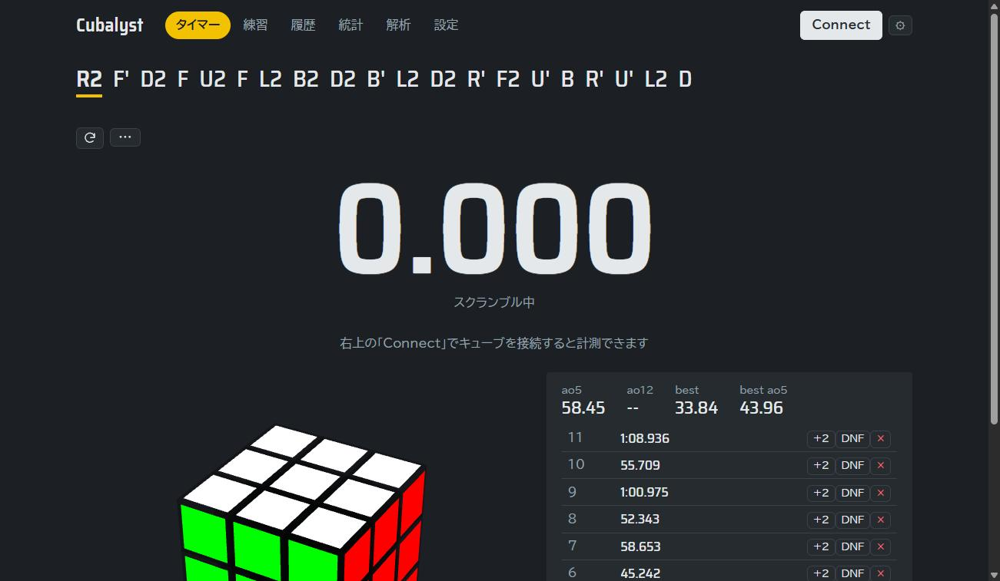
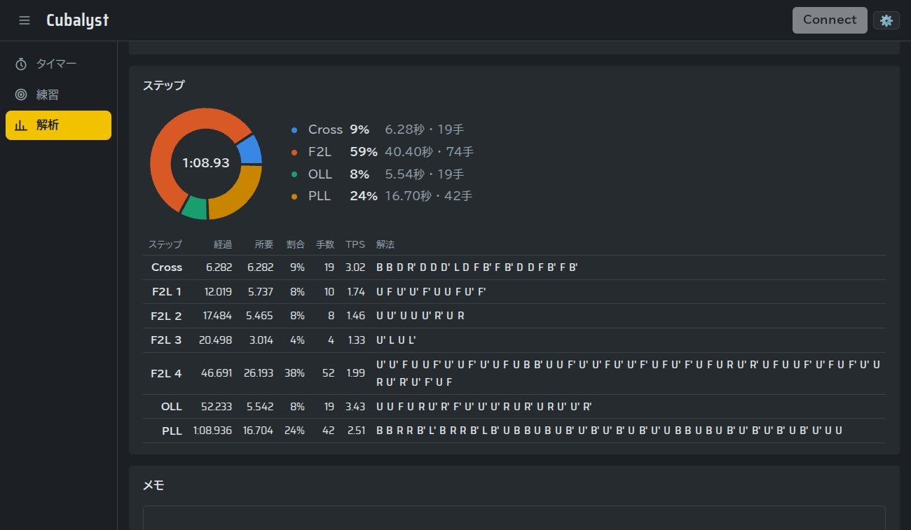
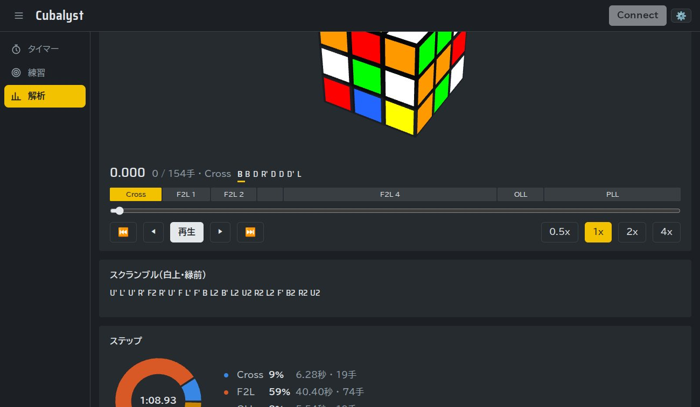
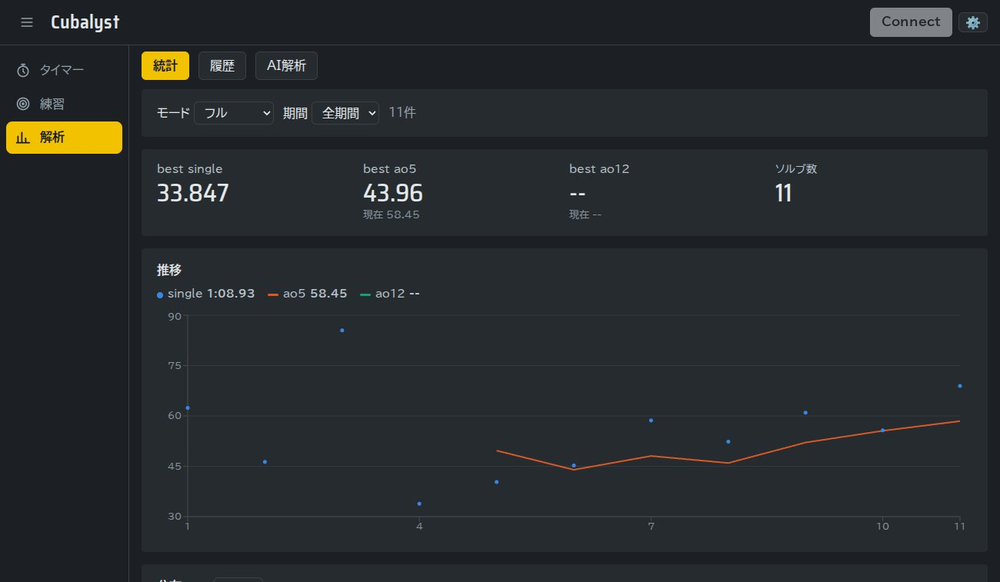
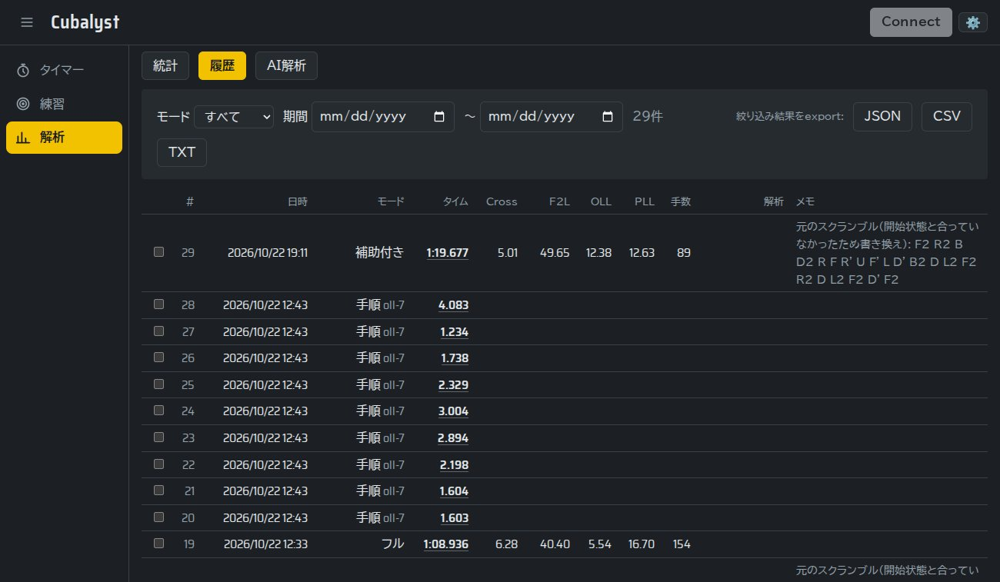
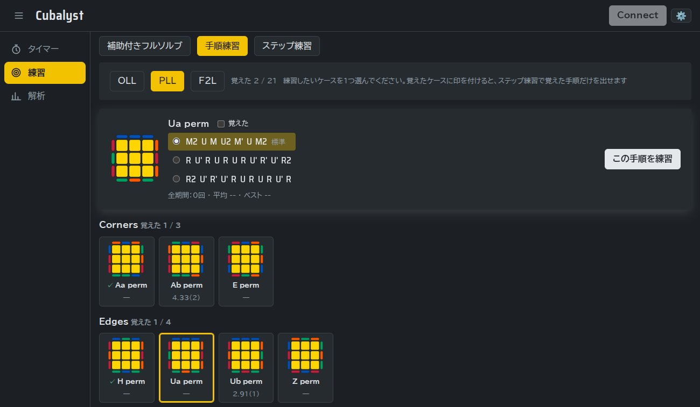
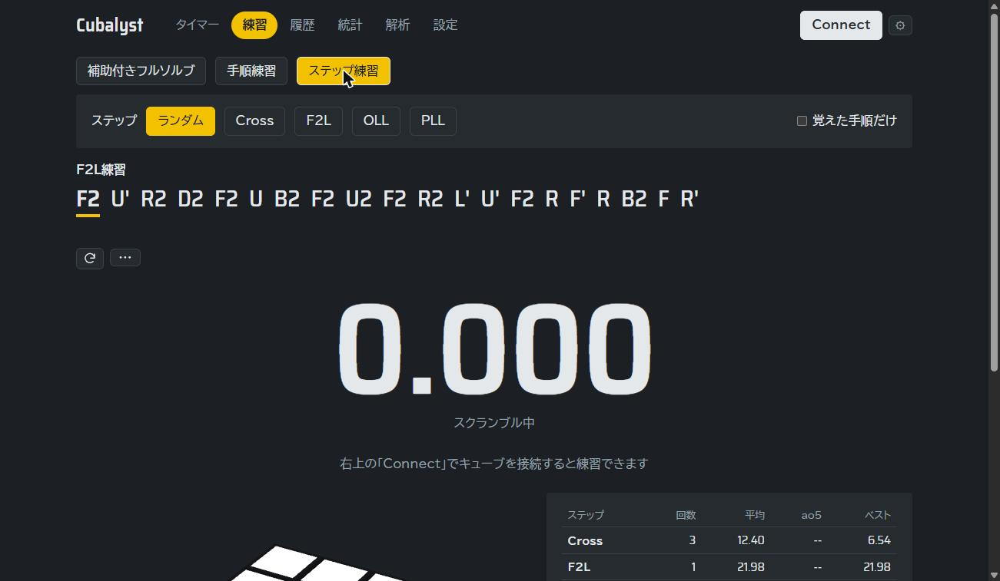
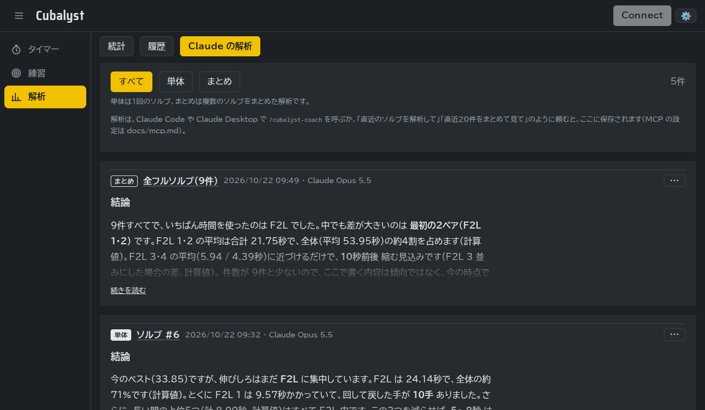

# Cubalyst

**スマートキューブで解いた1回1回を、CFOP の段階ごとに記録・分析して、次の練習まで導くキューブタイマー。**

Bluetooth でつないだスマートキューブの回転をそのまま記録するので、タイムだけでなく、Cross・F2L・OLL・PLL の各段階にかかった時間、手数、TPS、止まっていた時間までわかります。苦手なケースは手順練習やステップ練習で繰り返し、AI にソルブを解析させてアドバイスをもらうこともできます。



## 特徴

### スマートキューブで、回すだけで計測

- WCA 準拠のスクランブルを表示し、キューブを回すと進み具合をハイライト。間違えたときは戻す手順を出します
- 揃えた瞬間に自動でタイマーが止まり、最初の1手で計測を始めます（WCA 方式の15秒インスペクションも選べます）
- 3D のキューブが実機と同じ動きをします

### 1回ごとに CFOP の段階で分解

解き終えると、回転のログから Cross・F2L（4ペア）・OLL・PLL の区切りを自動で見つけ、段階ごとの時間・割合・手数・TPS と解法を出します。ソルブはあとから1手ずつ再生できます。





### 統計と履歴

メニューの「解析」に、統計・履歴・AI解析をタブでまとめています。統計はベスト・ao5・ao12 とその推移、タイムの分布、段階ごとの平均を表示します。フルソルブでは、各段階を始めたときのケース（OLL・PLL・F2L）ごとに、時間・認識・手数を並べ、全体の平均より遅い分が大きい順に出します。そこから手順練習へ移れます。履歴は期間やモードで絞り込み、JSON・CSV・テキストで書き出せます。





### 練習

- **手順練習**：OLL 57・PLL 21・F2L 41 のケースから1つ選び、その手順を何度も回して1回ごとの時間を測ります。キューブが揃っていなくても、手順を回し終えるたびに記録します。「この形にする」を押すと、今のキューブの状態からそのケースの形へ持っていく手順を出し、回し終えたところから計測します。ケースによっては別の手順も選べ、覚えたケースに印を付けられます
- **ステップ練習**：Cross・F2L・OLL・PLL の直前の状態から、その段階だけを測ります。「覚えた手順だけ」にすると、印を付けたケースだけが出ます
- **補助付きフルソルブ**：ふつうに解きながら、今の F2L のペア・OLL・PLL のケースと手順を画面に出します。記録はタイマーとは分けて保存します





### AI による解析

Cubalyst は記録を [MCP](https://modelcontextprotocol.io/) のツールとして公開します。MCP に対応した AI ツール（Claude Code、Claude Desktop、Codex CLI など）につなぐと、AI がソルブの記録を読んで、伸びしろの大きい点と次の練習を提案し、アプリに保存します。1回のソルブの「単体」の解析と、複数のソルブを「まとめ」た解析があります。解析の観点と出力の形式は、MCP の接続時にサーバーから AI へ渡しています。API キーは要らず、使っている AI ツールのプランの利用枠で動きます（動作を確かめているのは Claude Code と Claude Desktop です）。



### そのほか

- **持ち方に合わせた表記**：解法・再生・解析の記号を、自分の持ち方（下の色・前の色）に合わせて読み替えます
- **持ち替えの記録**：ジャイロのあるキューブ（GAN i4 などの Gen4）なら、ソルブ中の持ち替え（y・x・z）も記録し、解法をその時点の持ち方で表示します。設定でオンにし、キューブ側のジャイロは GAN のアプリの省電力の設定で切り替えます（ジャイロは電池を多く使います）
- **クロス色**を設定でき、白以外のクロスでも段階を正しく分けます（設定は右上の ⚙ から開きます）
- 記録は手元の SQLite ファイルに保存し、外部のサービスには送りません

## 対応しているもの

- **キューブ**：[smartcube-web-bluetooth](https://github.com/poliva/smartcube-web-bluetooth) が対応している GAN / MoYu / QiYi / GiiKER / GoCube のスマートキューブ（実機で確かめているのは GAN i4）
- **ブラウザ**：Web Bluetooth が使える Chrome / Edge（Windows・macOS・Android）。iPhone・iPad の Safari ではキューブをつなげません（記録や統計は見られます）

## はじめかた

Go 1.27 以上、Node.js 22 以上、GNU make が必要です。

```bash
git clone https://github.com/riwn/cubalyst.git
cd cubalyst
make dev
```

`Local: http://127.0.0.1:5173/` と表示されたら、ブラウザで <http://localhost:5173> を開きます。記録は `data/cubalyst.db` に保存されます。

### キューブをつなぐ

1. 画面右上の「Connect」を押し、表示された一覧からキューブを選びます
2. GAN のキューブは、通信の暗号化に MAC アドレスを使います。自動で取れなかったときは入力欄が出るので、`chrome://bluetooth-internals` や OS の Bluetooth 設定で確認して入力します（ブラウザに保存され、次回からは聞かれません）

Chrome で `chrome://flags/#enable-experimental-web-platform-features` を有効にすると、MAC アドレスを自動で取れることがあります。

### 使い方の例

- **ふだんの計測**：「タイマー」で解き、「解析」の「履歴」でソルブを開いて段階ごとの時間を見る。キューブをつないでいないときは、Space（スマホはタイマーをタッチ）で操作するふつうのタイマーとして使えます（記録は保存しません）
- **苦手の練習**：「解析」の「統計」で遅い段階を見つけ、「練習」の手順練習・ステップ練習でそこを繰り返す
- **アドバイスをもらう**：MCP でつないだ AI に「直近20件をまとめて見て」と頼み、「解析」の「AI解析」で結果を読む

## ドキュメント

| 内容 | ファイル |
|---|---|
| 起動方法の詳細、モック接続、設定、API、ディレクトリ構成、テスト | [docs/development.md](docs/development.md) |
| 常駐させて、同じ LAN のスマホやほかの PC から HTTPS で使う | [docs/lan.md](docs/lan.md) |
| AI ツールから MCP でつないで解析する（設定例とスキル） | [docs/mcp.md](docs/mcp.md) |
| 最初の仕様 | [cubalyst-spec.md](cubalyst-spec.md) |

> **注意**：Cubalyst は自分の PC（または自宅のサーバー）で動かす、ひとり用のアプリです。サーバーは `127.0.0.1` でだけ待ち受け、認証はありません。

## ライセンス

[MIT License](LICENSE) です。

依存しているライブラリやフォントは、それぞれのライセンスに従います。たとえば、cubing.js は MPL-2.0 または GPL-3.0-or-later、同梱しているフォント（Saira Semi Condensed、BIZ UDPゴシック）は SIL Open Font License 1.1 です。
